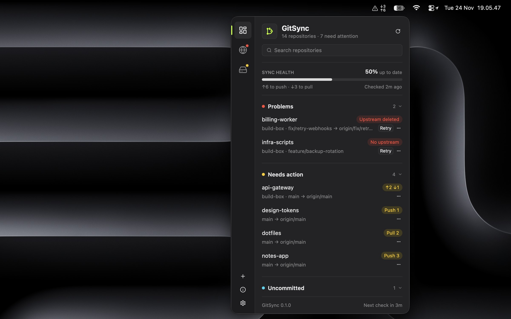

# GitSync

**A macOS menu bar app for repository sync status.** See at a glance which Git
repositories on your Mac and your SSH computers need a push, a pull, or an
upstream fix.

[](https://github.com/hizkiajuan/gitsync/actions/workflows/ci.yml)
[](LICENSE)
[](https://github.com/hizkiajuan/gitsync/releases)



GitSync shows which Git working trees beneath explicitly selected local or SSH
folders need a push, pull, or upstream fix. It never pushes, pulls, edits
files, changes branches, or scans outside those selected roots.

## Install

GitSync is distributed as source for now; signed and notarized downloads will
follow. Build it on a Mac with Apple Silicon and macOS 13 or later:

```sh
git clone https://github.com/hizkiajuan/gitsync.git
cd gitsync
GITSYNC_BUILD_PROFILE=release ./scripts/bundle.sh
mv dist/GitSync.app /Applications/
open /Applications/GitSync.app
```

You need Xcode Command Line Tools (`xcode-select --install`) and
[rustup](https://rustup.rs); the right Rust version installs itself. The
bundle is signed ad hoc, so it runs on the Mac that built it. Intel Macs are
not tested yet.

## Non-goals

GitSync stays a read-only monitor. It will not:

- push, pull, merge, rebase, commit, or change branches;
- edit, stage, or delete files in a repository;
- scan folders you did not select, or follow symlinks out of them;
- store passwords, tokens, or private keys, or prompt for them;
- send data to a server (no account, analytics, or telemetry).

## Requirements and tested host

- Deployment target: macOS 13 or later, based on the native APIs in use
- Runtime smoke-tested so far: macOS 26.6.2 on Apple Silicon
- Rust 1.98.1, installed automatically through `rust-toolchain.toml`
- `/usr/bin/git`, or another executable selected and tested in GitSync Settings

GPUI Kit 0.11.0 is pinned in `Cargo.toml` and `Cargo.lock`.
The macOS 13 deployment floor is not yet a claim of a complete version matrix;
each supported macOS version and architecture still requires its release smoke
run.

## Build from source

Use Cargo as the canonical build and package manager:

```sh
cargo fmt --check
cargo check
cargo clippy --all-targets --all-features -- -D warnings
cargo nextest run
```

`cargo-nextest` and `sccache` are optional developer tools. When `sccache` is
installed, set `RUSTC_WRAPPER=sccache` in your shell. Do not use `cargo build`
or `cargo run` merely for type checking.

Build and launch the local ad-hoc-signed application bundle only when runtime
verification is needed:

```sh
./scripts/bundle.sh
open dist/GitSync.app
```

The bundle runs as an `LSUIElement` menu bar accessory and does not show a
normal Dock icon. See the Release checklist in
[CONTRIBUTING.md](CONTRIBUTING.md#release-checklist) for the interactive smoke tests.

Debug builds can open one window at launch for screenshots and smoke tests
that cannot click the menu bar. Set `GITSYNC_DEBUG_OPEN` to `panel`,
`settings`, `repositories`, `advanced`, or `remote`. Use `panel:local` or
`panel:remote:<destination>` to open the panel on one computer, and
`panel:<first>><second>` (for example `panel:local>overview`) to switch views
after two seconds, as a rail click would. With `remote`, also set
`GITSYNC_DEBUG_REMOTE=destination|folder` to start a scan right away. Run with a scratch `HOME`
to keep your own configuration untouched:

```sh
HOME=/tmp/gitsync-home GITSYNC_DEBUG_OPEN=panel ./target/debug/gitsync
```

For screenshots without your own repositories, `./scripts/demo.sh` builds 14 demo repositories in every state GitSync shows (ahead, behind, diverged, no upstream, upstream deleted, uncommitted, up to date) under `/tmp/gitsync-demo`, and launches `dist/GitSync.app` on them with a scratch `HOME`, so your own configuration is never touched. Quit your own GitSync first. To show a second computer, add an SSH alias for this Mac (Remote Login on, your own key in `~/.ssh/authorized_keys`):

```sshconfig
Host build-box
  HostName localhost
```

The panel closes when GitSync is not the active app. Set `GITSYNC_DEBUG_PIN=1`
in a debug build to keep it open, for example while a script takes a
screenshot with `screencapture -l <window id>`.

## App icon and mark

`resources/icon/mark.svg` is the GitSync mark: a local branch lane with a remote lane that loops back into it through an arrow, so the branch graph reads as "sync". The menu bar shows it as a template image, and the panel, empty states, and **About** show it in the accent color.
`resources/icon/AppIcon.svg` places the app icon on the macOS icon grid: the same mark in two colors on a dark tile, the local lane in lime and the remote lane in paper. After editing either SVG, run `./scripts/make-icon.sh` on a Mac to regenerate `resources/AppIcon.icns`, and commit the result; `bundle.sh` only copies it.

## Folder discovery and SSH

**+ → Add Local Folder…** (in the panel's left rail) recursively imports Git working trees beneath the
selected local folder. Discovery does not follow symlinks, stops descending
after finding a repository root, and skips (and counts) subfolders it cannot
read. A scan shows its progress and can be canceled.

**+ → Add SSH Computer…** opens a small window. Enter a destination accepted by
OpenSSH, such as `workstation` or `user@host` (an optional leading `ssh ` is removed),
then enter `~/Git` for a folder beneath the remote account’s home directory,
`.` for the home directory itself, or an absolute remote path.
GitSync invokes `/usr/bin/ssh` in batch mode and uses existing `~/.ssh/config`,
known-host, agent, and keychain setup. It never stores a password or private
key. Establish and verify the host connection in Terminal before scanning;
interactive password and host-key prompts are intentionally unsupported.
**Test Connection** checks the batch-mode login and the remote Git version,
and previews how many repositories a scan of the folder would find, before
anything is added. Press Return to scan; the window closes when the scan succeeds.
Commands for one host share an SSH control connection (a socket under
`/tmp/gitsync-<uid>/`, kept for 60 seconds) instead of opening one connection
per command.

Discovery runs read-only `find` and Git inspection commands on the remote
computer. It skips large tool folders such as `node_modules`, `.cache`, and
`Library`, ignores repositories nested inside another repository, and keeps the
results it found when some folders are unreadable. A later consented fetch also
runs there, using that computer’s Git configuration and credentials.

After a scan adds repositories, GitSync asks once whether they may fetch.
Choose **Not Now** to decide later for each repository, or use **Allow…**
under **Sync health** in the panel.

Adding a folder that is already monitored syncs it instead of duplicating it. Repositories already monitored stay as they are, new ones are added, and a repository that moved (say from `~/Git/Private/app` to `~/Git/Public/app`) takes over its old entry, with its name, fetch consent and pause state, when its old folder is gone and exactly one new folder has the same name. Entries inside the scanned folder whose path no longer exists are removed. A scan that stopped at the repository limit never removes anything.

To point one repository at another folder yourself, choose **Change Folder…** in its menu in the panel (a folder picker on this Mac), or edit the path under its name in **Settings → Repositories** and press Return (this also works for SSH computers: `~/Git/app` or an absolute path). GitSync checks that the new folder is a Git working tree before it moves the entry.

Press **⌘G** in any app to open or close the menu-bar panel. GitSync claims
this shortcut system-wide while it runs, so other apps no longer receive ⌘G
(often "Find Next"). The panel is opaque and, in dark mode, uses a charcoal
palette (`#232325` content, `#1c1c1e` rail, `#343436` borders, `#ededed`
text, `#888888` secondary text, `#bfff00` accent) that Settings shares;
light mode uses the standard light theme.

The menu-bar panel has a left rail: **Overview** first, then one item per
computer (a red or amber dot marks a computer that needs attention), and
**+**, **Help**, and **Settings** at the bottom. The selected item stays
selected while the panel is closed. Each view shows a title with a badge,
**Refresh** (and for a computer **Pause** or **Resume**, plus **SSH** for a
remote one), a **Sync health** bar with the share of active repositories that
are up to date, push and pull totals, and the last check time, then sections
for **Problems**, **Needs action**, **Uncommitted**, **Unverified**, **Up to
date**, and **Paused**, each set off by a divider. Click a section heading to
fold or open it. Problems, Needs action, and Uncommitted start open; the others start folded and show
only their count. An open section lists five rows, then **Show N more**. The
panel remembers folded sections while it is closed. A search opens every
section and lists every match. The
footer shows the version and when the next scheduled check runs; a manual
refresh restarts that interval.

In Settings, repositories are grouped by the computer they run on. A group
opens expanded when something in it needs attention and collapsed otherwise,
until you expand or collapse it yourself. Pausing a group stops checking all
of its repositories, and **Remove** forgets every repository on that computer
without touching the remote files.

## How status is calculated

For each selected working tree, GitSync:

1. resolves the repository root and current branch;
2. reads the configured upstream;
3. optionally fetches only that upstream ref after repository-specific consent;
4. runs `git rev-list --left-right --count HEAD...@{upstream}`; and
5. maps the exact counts to Up to date, Push needed, Pull needed, or Diverged.

Uncommitted files are shown separately and never count as commits to push.
Background checks set `GIT_OPTIONAL_LOCKS=0`, so `git status` never takes
`index.lock` and cannot collide with your own commits.

The panel uses six states:

- **Action** (amber): commits to push or pull, or a diverged branch. Known
  counts stay actionable even when the remote cannot be reached right now.
- **Problem** (red): something you must fix, such as missing credentials, no
  upstream, a detached HEAD, or an upstream branch that was deleted on the
  remote.
- **Uncommitted** (blue): the branch has nothing to push or pull, but the
  working tree has changed, staged, conflicted, or untracked files. Uncommitted
  changes are known locally, so this state also applies while the remote state
  is unknown. Its pill counts the files, or shows **Conflicts**.
- **Unverified** (gray): the remote state is unknown because fetch is off, not
  yet allowed, offline, or not checked since launch.
- **Up to date** (green): nothing to push or pull and a clean working tree.
- **Paused**.

Uncommitted repositories count as needing attention and lower the
**Sync health** share; they do not cause notifications.

Each row shows the name and its status on the first line, and the branch and
actions on the second. Select a row (click it or use ↑ and ↓) to see the
guidance for a problem below it. A row offers at most
one main action (such as **Allow** or **Retry**) and a **⋯** menu for the
rest. Use ↑ and ↓ to
select a row, Return (or a double-click) to open it in Terminal or an SSH
session in that folder, and ⌘C to copy its path.

Hover a status pill to see what the state means and what to do next, for
example the `git push -u` command for a branch with no upstream.

### Open pull requests

When the [GitHub CLI](https://cli.github.com) (`gh`) is installed and signed
in on this Mac, each check of a repository with fetch consent also counts the
open pull requests that you authored on its GitHub remote. A row with open
pull requests shows a chip such as **2 PRs**; hover it to see how many are
awaiting review, have changes requested, are approved, or are drafts.
**Sync health** shows the total. GitSync runs
`gh pr list --author @me` with your own `gh` login and stores no GitHub token.
For SSH repositories, GitSync reads the remote URL on the remote computer and
runs `gh` on this Mac. Remotes that are not on github.com show no chip. If a
lookup fails, the last known count stays.

## Settings and privacy

Settings has three tabs: **General** (fetch, check interval including Manual,
wake refresh, notifications, launch at login, appearance), **Repositories**
(rename repositories and computers in place, pause, open, copy path,
remove), and **Advanced** (Git
executable, command timeout, diagnostics, about, and a danger zone with
**Reset…**). Each tab groups related settings in cards; destructive questions
open as sheets on the Settings window.

The panel search appears when a view lists more than six repositories and
searches every section. **Allow…** under **Sync health** grants fetch consent, after a confirmation, to the
monitored repositories in that view that are not paused; it does not change consent for
projects added later.

The menu bar shows the GitSync mark. When there is something to pull or push,
`↓pull` is stacked over `↑push` in a small font to its right; a zero side is
left out. The mark changes to a warning triangle when a repository has a
problem.

Checks run at most four at a time on each computer, and eight in all, so a
slow or unreachable SSH host does not hold up the others. While checks run,
the panel footer counts down the ones left.

Opening Settings or the SSH window from the panel keeps the panel open beside
it. The panel closes when another app becomes active.

Notifications are off by default. When on, GitSync notifies about remote
changes (commits to pull, or a diverged branch). Notifications about your own
commits to push are a separate opt-in. Changes found in the same check pass
are combined into one banner.

If GitSync cannot read its saved configuration (for example, after you open
an older version), it starts empty and does not save anything in that session,
so the saved files stay as they were. An unreadable cache is ignored and
rebuilt.

Configuration, cached snapshots, and bounded diagnostic logs remain under:

```text
~/Library/Application Support/GitSync/
```

GitSync has no account, analytics, telemetry, hosted service, or code upload.
Notifications omit paths, branches, and remote URLs. Diagnostic logs contain
opaque repository IDs, durations, normalized outcomes, and no repository
paths or credentials. Settings can reveal or delete those logs and copy a
sanitized diagnostic summary.

## Troubleshooting

- Use **Settings → Advanced → Test** after selecting a custom executable.
- If a remote scan fails with "Git is not on the remote PATH", make `git`
  available to non-interactive SSH logins on that computer.
- For an SSH-hosted working tree, fetch runs on that remote computer. If its
  Git remote uses HTTPS, configure a credential helper on that computer or
  authenticate there interactively first. GitSync deliberately sets
  `GIT_TERMINAL_PROMPT=0` and never captures GitHub usernames or tokens.
- A failed fetch preserves the last matching comparison as explicitly stale.
- Login-item approval is managed by macOS under **System Settings → General →
  Login Items**.
- Notification delivery is managed by macOS under **System Settings →
  Notifications**.
- Use **Settings → Advanced** to copy a summary, reveal local data, inspect
  logs, or reset GitSync metadata. Reset also turns off launch at login and
  never touches repositories.

## Contributing

Bug reports and bug-fix pull requests are welcome. Please open an issue before
you start a feature. See [CONTRIBUTING.md](CONTRIBUTING.md).

## Security

Report vulnerabilities privately; see [SECURITY.md](SECURITY.md).

## License

GitSync is released under the [MIT License](LICENSE). Bundles built with
`cargo-about` installed include the licenses of all third-party crates
(**Settings → Advanced → About → Licenses**).
